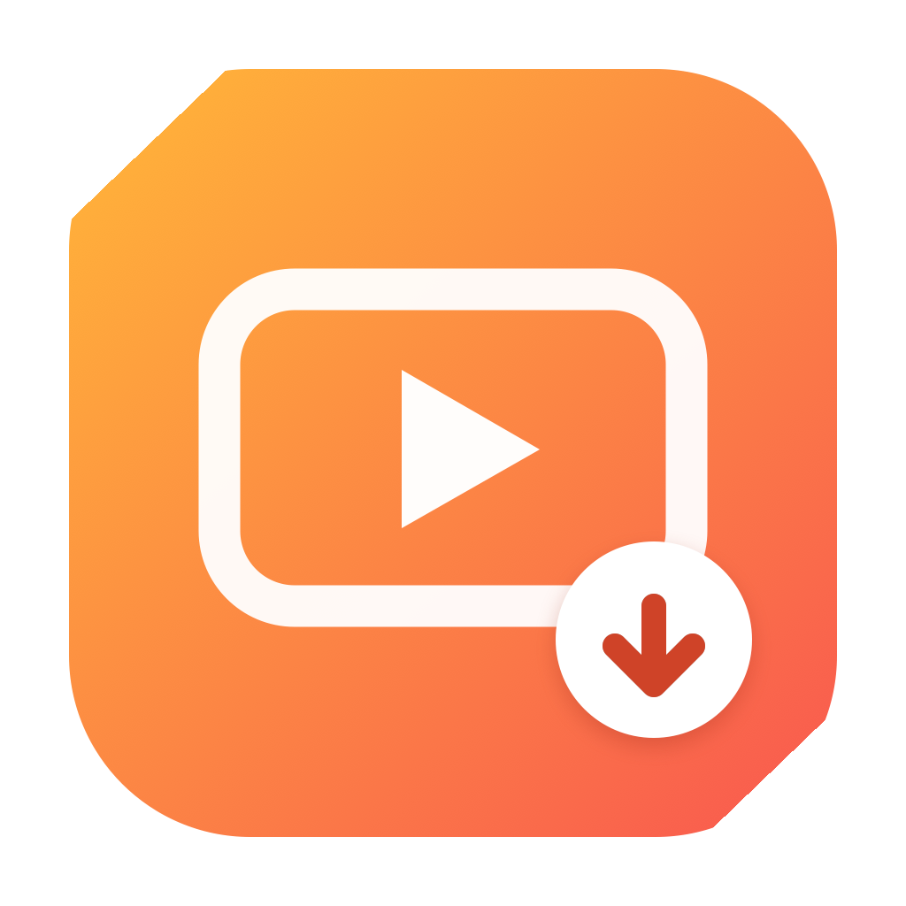
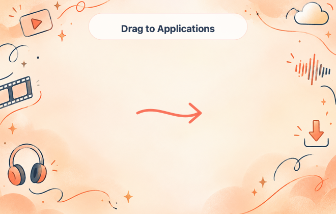

<div align="center">
  

  # YouTube Downloader for macOS

  A native SwiftUI app for downloading videos you own or have permission to save, creating QuickTime-compatible files, and converting local videos without a trip to Terminal.

  **Current release: 2.6.4 Beta · Apple silicon · macOS 26 or later**
</div>

> This independent project is not affiliated with, endorsed by, or sponsored by YouTube or Google. Use it only for media you created, own, or have permission to download.

> [!IMPORTANT]
> This is an experimental unsigned beta. It is ad hoc signed and has not been notarized by Apple, so macOS may require **Open Anyway** on first launch.

## What it does

- Downloads a video as a QuickTime-compatible MP4.
- Extracts audio as an MP3 at 128, 192, or 320 kbps.
- Offers Fast, Balanced, and High Quality video conversion modes.
- Converts existing videos to H.264 MP4, HEVC MP4, or ProRes MOV.
- Shows download and conversion progress in the app.
- Installs yt-dlp, FFmpeg, and FFprobe through a one-time in-app setup, so users do not need Homebrew or Terminal.
- Checks the official yt-dlp GitHub release for updates from the Settings tab.
- Verifies the SHA-256 digest published in GitHub release metadata before installing an yt-dlp update.
- Follows the system light or dark appearance.

## Installer preview

<div align="center">
  
</div>

The DMG uses a compact Finder window with a branded orange and coral background.

## Installation

1. Download `YouTube Downloader 2.6.4 Beta.dmg` from the latest GitHub prerelease.
2. Open the DMG.
3. Drag **YouTube Downloader** onto **Applications**.
4. Open the app from Applications.
5. When the setup popup appears, select **Install Tools**, then select **Restart App** when installation finishes.

### If macOS blocks the app

This beta is not Developer ID signed or notarized:

1. Try opening the app once.
2. Open **System Settings → Privacy & Security**.
3. Find the message about YouTube Downloader and select **Open Anyway**.
4. Confirm the prompt, reopen the app, and select **Install Tools**.

## One-time tool setup

The 2.6.4 DMG does not contain yt-dlp, FFmpeg, or FFprobe. The app downloads them directly from the configured project sources during optional one-time setup, verifies their SHA-256 fingerprints, and stores them under `~/Library/Application Support/YouTube Downloader/Tools`. After installation, the popup requires a restart. The app fully quits before opening one clean replacement instance, ensuring every tool is loaded correctly. No Terminal commands are required.

## Download modes

### Video

| Mode | Encoder | Best for |
|---|---|---|
| Fast | Apple VideoToolbox when available | Quick conversions with lower CPU use |
| Balanced | Software H.264 | A balance of quality and file size |
| High Quality | Software H.264 | More detail when conversion time is less important |

Downloaded videos are converted to H.264 video with AAC audio in an MP4 container for broad QuickTime compatibility.

### Audio

| Quality | Suggested use |
|---|---|
| 128 kbps | Speech and smaller files |
| 192 kbps | General listening and podcasts |
| 320 kbps | Highest available MP3 setting |

The source audio limits the actual quality. Converting a low-quality source to 320 kbps cannot restore missing detail.

## QuickTime Converter

The converter tab accepts a local video and creates one of these formats:

- **H.264 MP4:** widest QuickTime compatibility.
- **HEVC MP4:** potentially smaller output for newer Macs.
- **ProRes MOV:** large editing-friendly files.

## yt-dlp updates

The Settings tab can check for new yt-dlp releases automatically or on demand.

Updates:

- Come only from the official [`yt-dlp/yt-dlp`](https://github.com/yt-dlp/yt-dlp) GitHub repository.
- Use the `yt-dlp_macos` release asset.
- Must match GitHub's published SHA-256 digest.
- Are stored under `~/Library/Application Support/YouTube Downloader/Tools`.
- Do not modify the signed application bundle.

FFmpeg and FFprobe stay pinned to the tested versions shipped with the app.

## Building from source

The current release script targets Apple silicon and macOS 26:

```zsh
zsh Scripts/package-release.sh
```

The script:

1. Compiles the SwiftUI application.
2. Bundles the icon and third-party notices, without bundling tool executables.
3. Applies an ad hoc code signature for beta testing.
4. Creates the app, ZIP, and branded DMG in `dist/`.
5. Verifies the archives and creates SHA-256 checksums.

The script automatically uses the macOS SDK installed with Xcode or the Xcode Command Line Tools. It does not require one hard-coded SDK folder.

The primary source file is [`Sources/YouTubeDownloader.swift`](Sources/YouTubeDownloader.swift).

## Bundled components

| Component | Version | Purpose |
|---|---:|---|
| [yt-dlp](https://github.com/yt-dlp/yt-dlp) | Current verified release | Downloaded during setup |
| [FFmpeg](https://ffmpeg.org/) | 9.0.2 | Downloaded during setup |
| FFprobe | 9.0.2 | Downloaded during setup |

See [`ThirdParty/THIRD_PARTY_NOTICES.md`](ThirdParty/THIRD_PARTY_NOTICES.md) and [`ThirdParty/Licenses`](ThirdParty/Licenses) for bundled license information.

Before publishing a binary release, complete every applicable item in [`PUBLIC_RELEASE_CHECKLIST.md`](PUBLIC_RELEASE_CHECKLIST.md). The downloadable app does not contain third-party tool executables; tools are obtained separately during setup and retain their own licenses.

> [!NOTE]
> The app does not redistribute the tool executables in its DMG. Tools downloaded during setup retain their respective licenses. This repository includes notices and links to their projects.

## Known limitations

- The current 2.6.4 build supports Apple silicon and requires macOS 26 or later.
- The beta app and DMG are not Developer ID signed or notarized, so Gatekeeper may require manual approval.
- Intel and older macOS work remains experimental and is maintained separately.
- Website changes can temporarily break downloads until yt-dlp provides an update.
- Download and conversion speed depends on the source, network, selected quality, and Mac hardware.

## Responsible use

Use this app only for videos and audio you created, own, or have permission to download. You are responsible for following copyright law, the source website's terms, and any licenses attached to the media.

## Project status

This started as a small proof of concept and is still a learning project. Bug reports and careful testing are welcome, especially on clean macOS installations.
